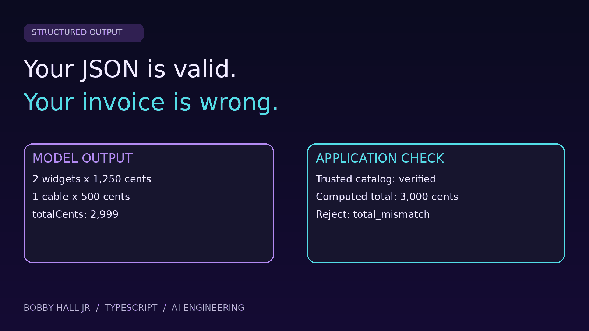

# Structured output needs business invariants



A tiny TypeScript acceptance boundary for untrusted invoice-shaped JSON. It checks parseability, exact structure, safe integer arithmetic, trusted catalog prices, unique SKUs, and recomputed totals. No API key or model call.

## Run

Prerequisites: Node.js 22+ with npm. Tested on Node.js 22.20.0 and TypeScript 5.9.3. Network access is needed for installation.

```sh
git clone https://github.com/bobbyhalljr/structured-output-invariants.git
cd structured-output-invariants
npm ci
npm test
```

The command builds TypeScript before running 18 deterministic fixture checks. See [exact full output](test-output.txt). The final line is `Checks passed: 18/18`. Any unexpected reason throws and fails the command.

[Read the illustrated article](article.md). [Read the live DEV article](https://dev.to/bobbyhalljr/your-json-is-valid-your-invoice-is-wrong-build-a-semantic-gate-in-typescript-32c5).

## Files

- `src/demo.ts`: validator and 18 inline fixtures.
- `images/`: cover and two diagrams.
- `test-output.txt`: tested output.
- `article.md`: full tutorial with primary references.

## Limits

Static USD-only catalog; no taxes, discounts, currencies, fractional quantities, persistence, LLM accuracy evaluation, or automatic repair. Duplicate SKUs are rejected by deliberate toy policy. Input limit counts JavaScript code units. Acceptance does not authorize payment. Production needs version-consistent catalog reads/writes, tenant access, authorization, idempotency, and bounded retries.

## References

- [JSON Schema numeric constraints](https://json-schema.org/understanding-json-schema/reference/numeric)
- [JSON Schema object constraints](https://json-schema.org/understanding-json-schema/reference/object)
- [TypeScript assertions have no runtime validation](https://www.typescriptlang.org/docs/handbook/2/everyday-types.html)
